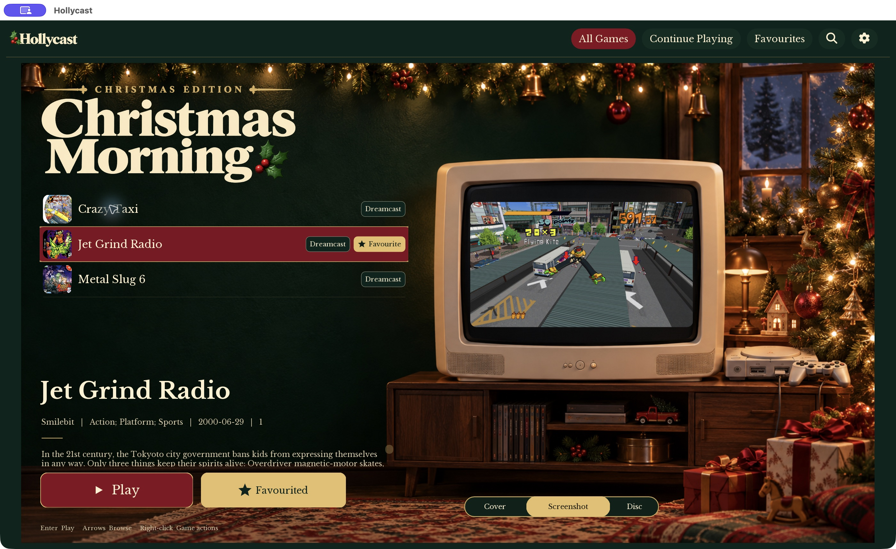
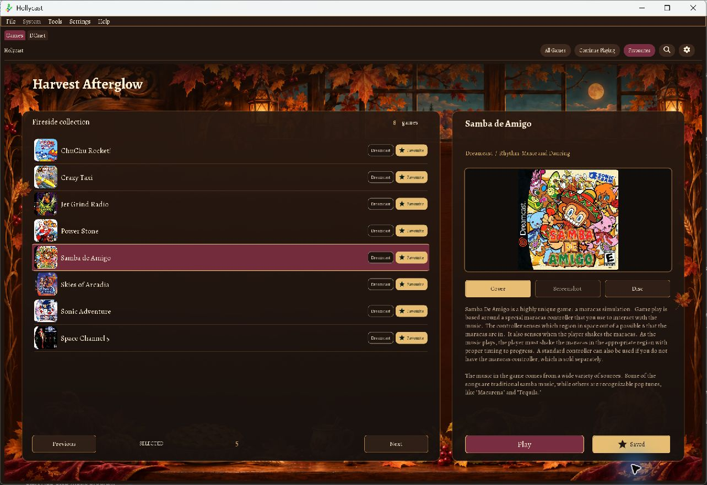
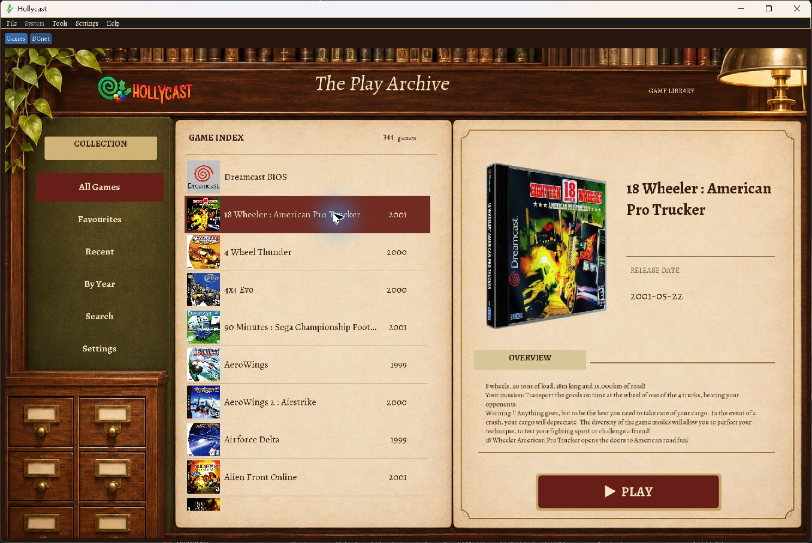
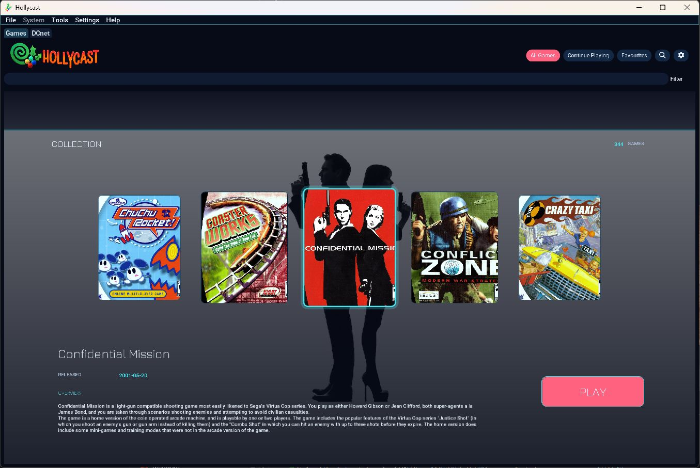
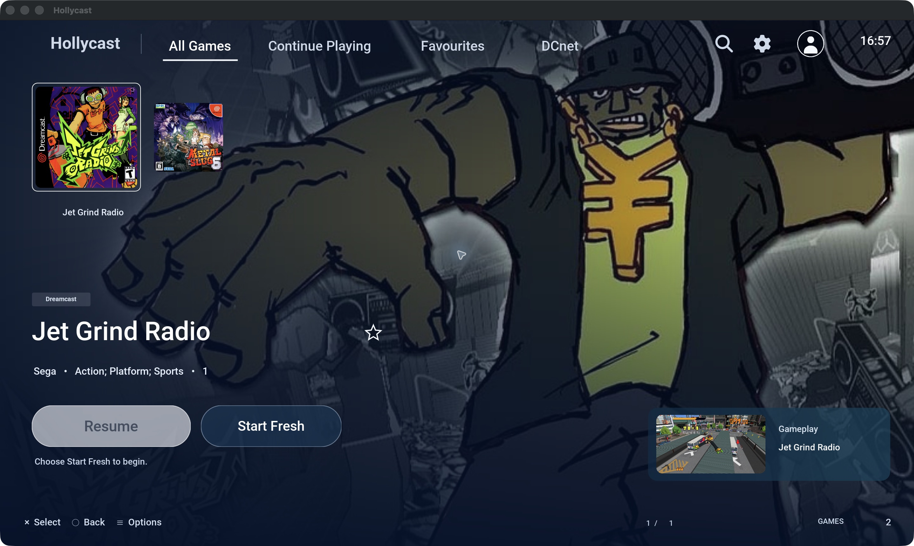

<!-- Portions Copyright 2026 The Hollycast Authors -->
<p align="center">
  
</p>

<h1 align="center">Hollycast Themes</h1>

<p align="center">
  Community library themes for <a href="https://github.com/nexus382/Hollycast">Hollycast</a>, the community-built Dreamcast, Naomi, Naomi 2 and Atomiswave emulator.
</p>

<p align="center">
  <a href="https://github.com/TnT-Studio-s/Hollycast-themes/actions/workflows/validate.yml"></a>
  <a href="catalog.json"></a>
  <a href="LICENSE"></a>
  <a href="https://hollycast.org"></a>
  <a href="https://discord.gg/8s8Ecc2BxR"></a>
</p>

This repository is the theme catalogue that Hollycast reads from. Every theme
here can be browsed, downloaded and applied from inside the emulator. You do not
need Git, a GitHub account or a separate installer.

- [Theme gallery](#theme-gallery)
- [Installing a theme](#installing-a-theme)
- [Compatibility](#compatibility)
- [Contributing a theme](#contributing-a-theme)
- [Catalogue format](#catalogue-format)
- [Licensing](#licensing)

## Theme gallery

<table>
  <tr>
    <td width="50%" valign="top">
      <a href="themes/christmas-morning"></a>
      <h3><a href="themes/christmas-morning">Christmas Morning</a></h3>
      A nostalgic Christmas room with ivory serif type, a cover list, cranberry
      and gold controls, and a CRT preview that "retunes" between games.
      Wide and portrait layouts.
    </td>
    <td width="50%" valign="top">
      <a href="themes/harvest-afterglow"></a>
      <h3><a href="themes/harvest-afterglow">Harvest Afterglow</a></h3>
      A candlelit Thanksgiving lodge with painted maple leaves, cranberry and
      brass controls and storybook type. Full-width cover gallery, fireside
      list and a dedicated portrait layout.
    </td>
  </tr>
  <tr>
    <td width="50%" valign="top">
      <a href="themes/play-archive"></a>
      <h3><a href="themes/play-archive">Play Archive</a></h3>
      An antique reading room with a live game index, parchment pages, an olive
      collection sidebar and a large case-art preview.
    </td>
    <td width="50%" valign="top">
      <a href="themes/signal-bloom"></a>
      <h3><a href="themes/signal-bloom">Signal Bloom</a></h3>
      A midnight-neon cover carousel. The selected game's fanart fills the
      background, with cyan selection and coral PLAY controls.
    </td>
  </tr>
  <tr>
    <td width="50%" valign="top">
      <a href="themes/blue-hour"></a>
      <h3><a href="themes/blue-hour">Blue Hour</a></h3>
      A cinematic navy-and-white library with full-screen game artwork,
      an enlarged cover selection, real save previews and a matching DCnet page.
      Wide and portrait layouts. Requires the cinematic theme renderer build.
    </td>
  </tr>
</table>

Each theme folder has its own README with layouts, controls and rebuild steps.
Themes use artwork and metadata from your own library. No game art, ROMs or
BIOS files are included.

## Installing a theme

### From inside Hollycast (recommended)

1. Open **Settings → Library → Browse themes**.
2. Pick a theme to see its screenshots, creator and description.
3. Choose **Download and install**, then **Use theme**.

Installed themes are marked automatically. Restart Hollycast after changing
themes so the theme fonts refresh.

Hollycast never overwrites an installed theme. If a newer version appears in the
catalogue, you keep the copy you already have installed.

### Manually

1. Download a ZIP from [`packages/`](packages).
2. Extract it into a folder named after the theme ID, for example
   `signal-bloom/`. The ZIP has `theme.json` at its root.
3. Move that folder into `library-themes/` inside the data directory your
   Hollycast executable uses, so the path ends in
   `library-themes/<theme-id>/theme.json` with `assets/` beside it.
4. Restart Hollycast and select the theme under
   **Settings → Library → Library Themes**.

## Compatibility

Some themes use renderer features that are newer than the current stable
release. Older builds reject manifests that contain fields they don't know.

| Theme | Needs |
| --- | --- |
| Blue Hour | A build containing [Hollycast PR #69](https://github.com/nexus382/Hollycast/pull/69) (`aeddc1441`) with library actions, save previews, enlarged single-row covers and themed DCnet pages. Older stable and `dev` releases reject its manifest. |
| Christmas Morning | A build with list badges and keyboard-preview support. See [COMPATIBILITY.md](themes/christmas-morning/COMPATIBILITY.md). |
| Harvest Afterglow | A current [`dev` build](https://github.com/nexus382/Hollycast/releases/tag/latest-dev) with paged-grid, list-badge and portrait-fallback support. |
| Play Archive | The [`codex/play-archive-signal-bloom`](https://github.com/nexus382/Hollycast/tree/codex/play-archive-signal-bloom) development branch. |
| Signal Bloom | The [`codex/play-archive-signal-bloom`](https://github.com/nexus382/Hollycast/tree/codex/play-archive-signal-bloom) development branch. |

The catalogue does not yet enforce a minimum app version, so check this table
before installing.

## Contributing a theme

New themes are welcome. If you're new to the format, start with the
[Hollycast theme author guide](https://github.com/nexus382/Hollycast/blob/master/docs/Themes.md).

1. **Add the theme.** Create `themes/<theme-id>/` with a valid Hollycast
   `theme.json` and its assets. Keep all asset paths relative to that folder.
   The folder name must match the manifest's `id` (lowercase letters, digits,
   `-` and `_`).
2. **Fill in the metadata.** `name`, `author` and `description` in `theme.json`
   are required. They become the name, creator and description in the catalogue.
3. **Add screenshots.** Put one to eight real screenshots in
   `screenshots/<theme-id>/`. PNG or JPEG, at most 8 MiB, 8192 px on either
   side and 16 million pixels in total. Leave personal information out.
4. **Add `themes/<theme-id>/listing.json`:**

   ```json
   {
     "version": "1.0.0",
     "screenshots": ["screenshots/my-theme/library.png"]
   }
   ```

5. **Include licences.** Add a licence and attribution for everything you
   distribute: art, fonts and code.
6. **Build and test.** Run the builder, then install the theme locally in
   Hollycast to check its layouts, fonts and asset references.

   ```sh
   python3 build_catalog.py          # writes packages/ and catalog.json
   python3 build_catalog.py --check  # what CI runs
   ```

7. **Open a pull request** containing the theme source, screenshots, the
   generated ZIP in `packages/` and the updated `catalog.json`.

The builder needs only Python 3's standard library. It checks paths and
enforces the package limits: `theme.json` at the ZIP root, at most 256 files,
eight levels of nested folders and 64 MiB unpacked, and no symlinks.

## Catalogue format

Hollycast fetches the catalogue from:

```text
https://raw.githubusercontent.com/TnT-Studio-s/Hollycast-themes/main/catalog.json
```

Format version 1 has a `themes` array. Each entry has `id`, `name`, `creator`,
`description`, `version`, `package` and `screenshots`. Package and screenshot
paths are relative to `catalog.json`; the client also accepts HTTPS URLs.

Publish the catalogue and packages together. The
[validation workflow](.github/workflows/validate.yml) runs on every push and
pull request and fails if the generated files don't match the theme sources.

## Licensing

- Theme authors keep their copyright. Each theme ships its own `LICENSE.txt`
  and `ATTRIBUTION.md`.
- Bundled fonts are under their own licences (for example SIL OFL), included
  next to the font files.
- The catalogue builder (`build_catalog.py`) is licensed under
  GPL-2.0-or-later. See [LICENSE](LICENSE).

Hollycast is built on [Flycast](https://github.com/flyinghead/flycast). Theme
catalogue maintained by TnT Studio's.
